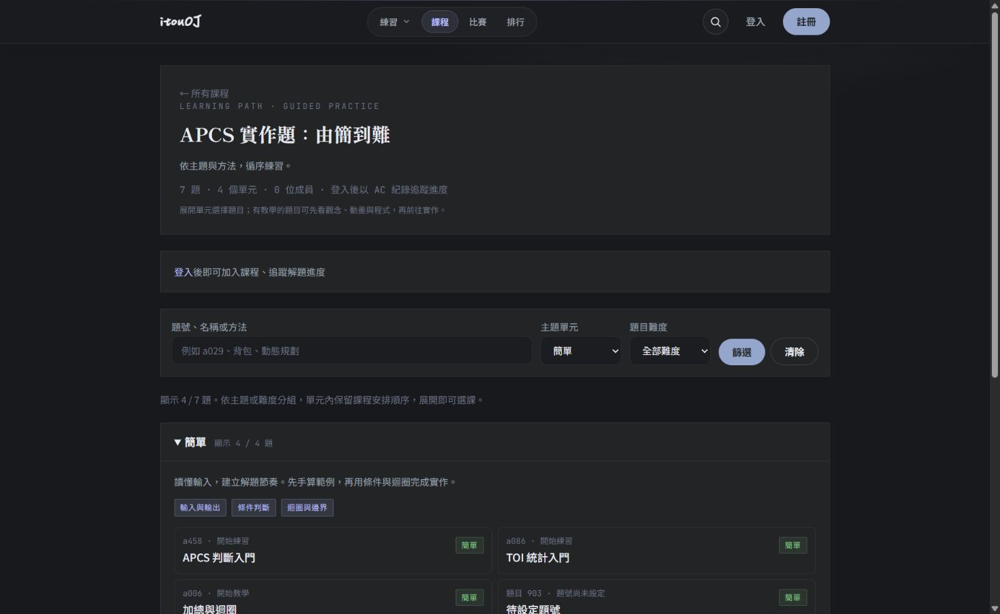
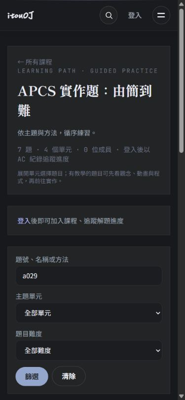

# Unified course overview

Database-backed courses (`/courses/[id]`) now follow the CPE / TOI potential overview pattern: introduction card, search and unit/difficulty filters, native collapsible units, two-column lesson cards on desktop and a single column on mobile.

## Content and access rules

- APCS archived problems retain their existing curriculum units and pedagogical code order. The previous duplicate full-bank table is replaced by one primary card per course entry.
- TOI beginner problems retain their existing topic grouping and teacher-defined order within each topic. Unmapped problems go into **其他練習**, without a made-up tutorial URL.
- APCS introductory and ordinary courses use easy / medium / hard groups. Nonstandard difficulty values are retained in **未分類難度**.
- Known programming lessons link to the existing tutorial. Other programming problems link to practice; recognition questions retain their recognition route. A programming problem with no code remains visible with an unavailable label instead of a broken URL.
- Units start collapsed. Search results expand their matching units. Repeated query parameters use the first value; invalid unit/difficulty selections are ignored.
- Full-course progress and rankings do not change when filtering. Unit summaries distinguish filtered counts from full-unit completion.
- Private courses/problems remain admin-only. Join codes are shown only to admins. Rankings are fetched and rendered only for members/admins; public courses still allow visitors to browse their public problems.

No migration, production data update, lesson rewrite, or dependency on the unmerged TOI potential PR is required. CPE and TOI potential keep their existing overview pages.

## Verification

```sh
npm run build
COURSE_LAYOUT_TEST_PRODUCTION=1 npm run test:course-layout
```

The tests use a disposable SQLite database with all migrations and a loopback-only server. Four pure tests cover complete APCS/TOI grouping, order, navigation and filtering. Five HTTP tests cover ordinary/APCS/TOI courses, no missing/duplicate cards, tutorial routes, combined/repeated filters, empty courses, AC progress, rankings and HTML/RSC privacy guards.

For a local browser preview, set `COURSE_LAYOUT_TEST_KEEP_DB=1` when running the HTTP tests. This intentionally retains only the disposable fixture database at the printed path; the test server is still stopped. Start a separate loopback server against that database with `AUTH_SECRET=course-layout-disposable-test-secret-not-production` and `COOKIE_SECURE=0`. Fixture courses 1–4 represent the ordinary, APCS introductory, APCS archived and TOI beginner layouts. Never point these tests at a real database.

### Browser verification

Verified against disposable fixtures on the production build: APCS archived unit expand/collapse, desktop two-column cards, mobile search submission, automatically expanded search results and navigation to the existing a029 tutorial. At a 390 × 844 viewport, document client/scroll widths were both 375 px (15 px scrollbar), with a single 309.6 px card column; desktop used two 471.2 px columns with no document overflow. Temporary viewport settings were reset afterward.

These screenshots show fixture content, not production course totals:




