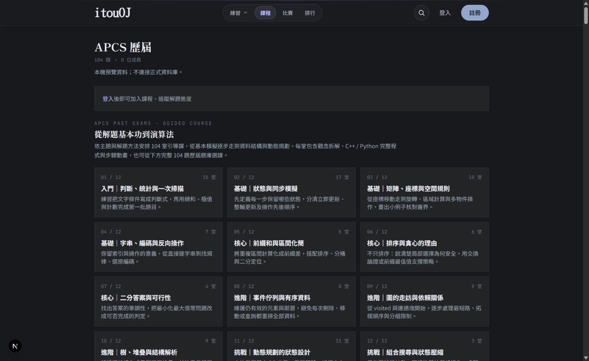
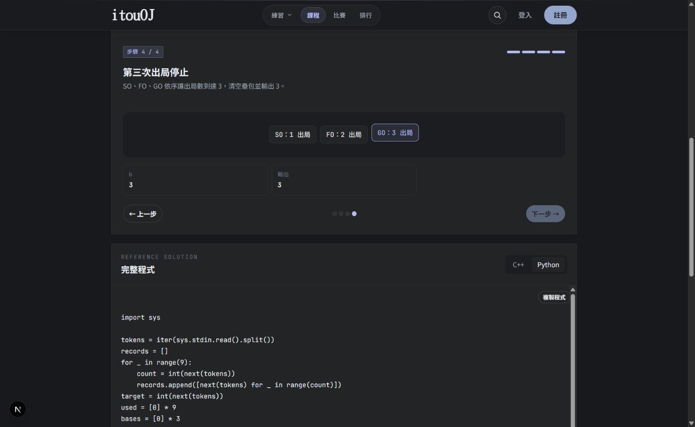

# APCS 歷屆教學

`APCS 歷屆` 課程的教學以本站公開題目 a356～a459 為準。公開範例保存於 `src/lib/apcsPastExamSamples.ts`，只包含題目頁可見的輸入與輸出，不包含隱藏測資。

新增教學時，使用 `definePastExamLesson`，填入題目專屬的解題推導、複雜度、陷阱、動畫狀態與完整 C++ / Python 程式。範例預設使用該題第一組公開範例。課程順序由 `apcsPastExamUnits` 決定；題目頁按鈕透過 `getCourseLesson` 與實際課程關聯決定，未公開課程不會提供給一般使用者。

目前 104 題各有一個主要單元，依基本判斷、狀態模擬、矩陣、字串、前綴和、貪心、二分答案、資料結構、圖、樹與解析、動態規劃、組合搜尋共 12 個階段安排。這是教學順序，不會改動資料庫的題目難度、題號或原有課程關聯。

## 題面未定義的邊界

教材以本站題面為準，不把來源題號相同當成規格完全相同。以下情況已在各課註記，部署教學不會擅自修改題面或隱藏測資：

- a375：孤立且仍有寶石的起點可能永遠轉向；程式有防止無限轉向的保護。題面也未給寶石總數的明確上界。
- a423：全圖皆為 `-1` 時沒有城市可取極值；程式採 `0、0` 作為防禦性結果。
- a441：若所有候選字串都已出現，題面未定義要輸出什麼；程式不自訂不存在的答案。

這些保護不是新增的評測規格；若日後題面補充定義，應同步更新教材與邊界測試。

## 驗證

執行 `npm run test:apcs-lessons` 會檢查 104 題的教學與課程順序是否齊全、重複或遺漏，並檢查動畫索引。若要實際執行參考程式，傳入本機工具路徑：

```text
npm run test:apcs-lessons -- --python /path/to/python3 --cxx /path/to/g++
```

可用 `--code a356,a357` 只驗證指定題目，或用 `--batch part1` 驗證單一內容批次。預設完整驗證會執行所有保存的公開範例，並比較輸出 token。C++ 使用 C++17 與 O2；Windows 下為支援 MSVC 標準函式庫，測試暫存檔會將 GNU 的 `bits/stdc++.h` 展開成標準標頭，教學原始程式不變。必要時以 `--temp-root /writable/directory` 指定編譯暫存目錄。

驗證不會向線上評測系統提交程式。公開範例通過仍不代表所有邊界與效能都正確，進階演算法另應以小規模暴力解、隨機比較或邊界資料檢查。

## 介面預覽

以下使用獨立本機測試資料庫，並非線上解題進度。已檢查 104 堂入口、動畫步驟、Python 切換、下一課重設至第 1 步，以及題目頁的「教學」連結。




